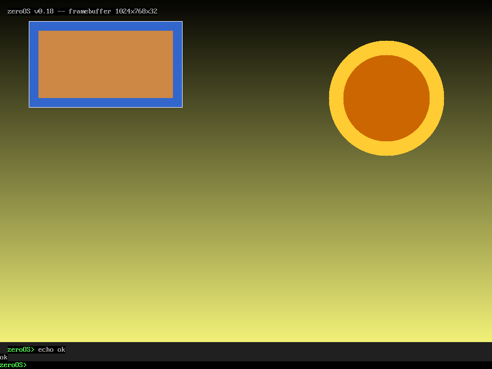

# v0.18 — 图形模式：帧缓冲 + 文字控制台（当前版本）

zeroOS 第一次有画面了：boot 阶段用 VBE 把显示切成 **1024×768×32 线性帧缓冲**，
内核把 LFB 映射到高地址，文字控制台直接画到帧缓冲上；`gfx` 命令画一个演示画面。

## 改动

| # | 改动 | 说明 |
|---|---|---|
| ① | boot.asm 设 VBE 模式 | `int 0x10` 4F01/4F02，模式 `0x144`（QEMU 的 1024×768×32）；LFB 物理地址写在 0x4500 |
| ② | BIOS 8×16 字库 | `int 0x10` 1130 取字库，拷到 0x8000；内核在开分页前读走 |
| ③ | LFB 映射 | 内核把 LFB 映射到虚拟 `0xFD000000`；分辨率 / 行宽 / bpp 从 VBE mode info 读，不写死 |
| ④ | 帧缓冲控制台 | `console_putc` 同时写 VGA 文本影子（0xB8000）和帧缓冲；支持 `\n \r \b \t`、滚动、清屏 |
| ⑤ | `gfx` 命令 | 渐变背景 + 矩形 + 圆 + 标题；命令行提示符落在底部黑条上 |
| ⑥ | 测试 | 第六阶段跑 `gfx`，用 QEMU `screendump` 抓帧缓冲，逐像素校验（纯标准库 PPM 解析） |

## 验证

| 配置 | 结果 |
|---|---|
| `pc` | ✅ 157/157（含 3 项图形断言） |
| `q35` / 486 / 2MB | 见 TEST-RESULTS |
| 像素校验 | 背景条 `(500,750)=(32,32,32)`、圆 `(804,220)=(204,102,0)`、矩形 `(100,100)=(204,136,68)` |

> 图形模式下 0xB8000 不再是一块普通内存（被 VGA 设备占用），
> 原先基于 `pmemsave 0xB8000` 的 5 项文本屏幕检查在图形模式下自动跳过，改由帧缓冲像素校验覆盖。

## 已知限制

- 只支持 32bpp；VBE 模式号用的是 QEMU 的 `0x144`，真机 / 其他虚拟机的编号可能不同（读 mode info 已兼容宽高与行宽，但模式号还要加探测）。
- 纯 CPU 绘制，没有双缓冲；全屏刷新（渐变）在 486 上会慢。
- 中文还不支持：字库只有 BIOS 的 8×16 ASCII。
- 图形模式是 boot 时定的；运行中切不回文本模式（BIOS 调用已经不可用）。

## 完整测试记录

[https://github.com/Holmes-2011/The-Develop-of-zeroOS/blob/main/versions/v0.18-gfx/TEST-RESULTS.md](https://github.com/Holmes-2011/The-Develop-of-zeroOS/blob/main/versions/v0.18-gfx/TEST-RESULTS.md)

---

**完整版本档案**：[https://github.com/Holmes-2011/The-Develop-of-zeroOS/blob/main/versions/README.md](https://github.com/Holmes-2011/The-Develop-of-zeroOS/blob/main/versions/README.md)
