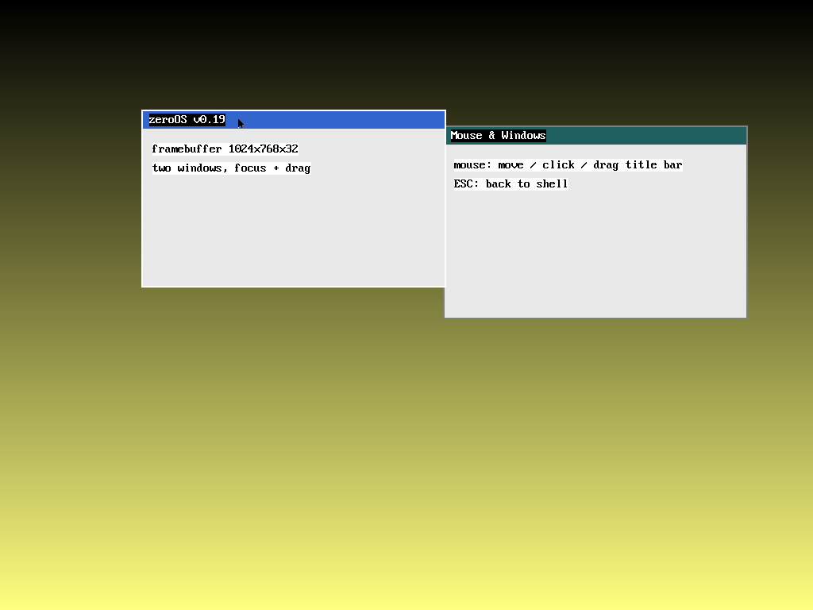

# v0.19 — 桌面：鼠标 + 窗口（当前版本）

开机就有图形背景，不再是黑底文字。输入 `desktop` 进入桌面：**鼠标指针 + 两个窗口**，
点标题栏可以拖动、点击可切换焦点，`ESC` 回命令行。



## 改动

| # | 改动 | 说明 |
|---|---|---|
| ① | PS/2 鼠标 | 8042 aux 通道 + IRQ12，3 字节包解析（dx / dy / 按键） |
| ② | 桌面 | 两个窗口（标题栏 / 边框 / 正文）、渐变背景、底部信息条 |
| ③ | 指针 | 8×12 箭头，绘制前保存背景、移动时先还原（不拖影） |
| ④ | 交互 | 点标题栏拖动、点窗口置顶、`ESC` 退出桌面 |
| ⑤ | 开机背景 | `gfx_background()`：深色渐变 + 底部条，启动即图形界面 |
| ⑥ | 测试 | 第七阶段：QEMU `mouse_move` / `mouse_button` 模拟拖动，`wminfo` 核对坐标，`screendump` 校验像素 |

## 使用

```
zeroOS> desktop        ← 进入桌面
  鼠标移动 / 点击 / 拖标题栏
  ESC                  ← 回命令行
zeroOS> wminfo         ← 打印窗口坐标和焦点（测试用）
```

## 验证

| 配置 | 结果 |
|---|---|
| pc | ✅ **160/160**（含 3 项桌面断言） |
| q35 | 见 TEST-RESULTS |
| 桌面断言 | 进入 / 退出正常；拖动后 `win0=180,140`；帧缓冲标题栏像素命中 |

## 已知限制

- 鼠标坐标只做了边界钳制，没有加速曲线。
- 窗口没有关闭按钮 / 缩放，只有两个固定窗口。
- 拖动时只重绘旧窗口和新窗口区域，不重叠的窗口没问题；大量窗口需要真正的合成器。
- 鼠标依赖 PS/2；USB 鼠标（USB 平板）还不能用。

## 完整测试记录

[https://github.com/Holmes-2011/The-Develop-of-zeroOS/blob/main/versions/v0.19-mouse/TEST-RESULTS.md](https://github.com/Holmes-2011/The-Develop-of-zeroOS/blob/main/versions/v0.19-mouse/TEST-RESULTS.md)

---

**完整版本档案**：[https://github.com/Holmes-2011/The-Develop-of-zeroOS/blob/main/versions/README.md](https://github.com/Holmes-2011/The-Develop-of-zeroOS/blob/main/versions/README.md)
