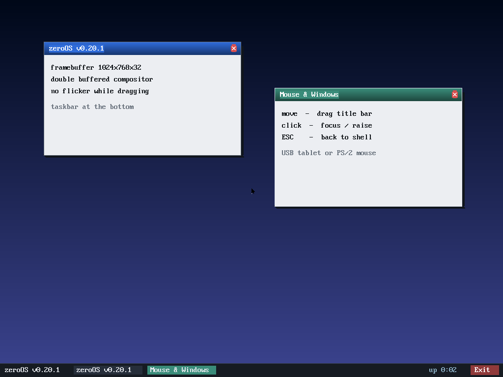

# v0.20.1 — 双缓冲桌面 + 不会把你关在里面（当前版本）

v0.20 的桌面有两个体验问题：拖动窗口会闪（像老 Macintosh 的中间帧），
而且进了桌面如果键盘不灵就出不来。这个补丁两个都修了。

## 改动

| # | 改动 | 说明 |
|---|---|---|
| ① | 双缓冲合成 | 桌面画到 3MB 后台缓冲，按脏区拷到前台；拖动时不再出现"旧窗口已擦、新窗口未画"的中间帧 |
| ② | 脏区重绘 | 指针移动只重绘 12×14 的一小块；拖窗口只重绘旧/新窗口的并集 |
| ③ | 窗口外观 | 阴影、标题栏渐变、关闭按钮、圆角感的双色边框 |
| ④ | 任务栏 | 底部任务栏：窗口按钮、开机时长、**Exit 按钮** |
| ⑤ | 退出兜底 | **ESC / q**、任务栏 Exit 按钮、**60 秒无输入自动退出** —— 三重保险，不会再被锁在桌面里 |
| ⑥ | 内存不够时降级 | 2MB 内存分不出后台缓冲时自动退回直接绘制（会闪，但能用） |

## 验证

| 配置 | 结果 |
|---|---|
| pc | ✅ 163/163（含桌面拖动、Exit 按钮、USB 平板拖动） |
| q35 | 见 TEST-RESULTS |
| 退出路径 | ESC 键 ✅、任务栏 Exit 按钮（鼠标）✅、60 秒空闲自动退出（代码路径） |

## 已知限制

- 仍是纯 CPU 软件合成：1024×768 全屏重绘在 TCG 上不快；拖动时只重绘脏区，所以能接受。
- 没有真正的圆角/模糊/动画，只是"看起来像窗口"。
- 后台缓冲要 3MB，2MB 内存的机器会降级成有闪烁的模式。
- 退出兜底的 60 秒空闲计时在演示时会显得突兀，可按需调整。

## 完整测试记录

[https://github.com/Holmes-2011/The-Develop-of-zeroOS/blob/main/versions/v0.20.1/TEST-RESULTS.md](https://github.com/Holmes-2011/The-Develop-of-zeroOS/blob/main/versions/v0.20.1/TEST-RESULTS.md)

---

**完整版本档案**：[https://github.com/Holmes-2011/The-Develop-of-zeroOS/blob/main/versions/README.md](https://github.com/Holmes-2011/The-Develop-of-zeroOS/blob/main/versions/README.md)
