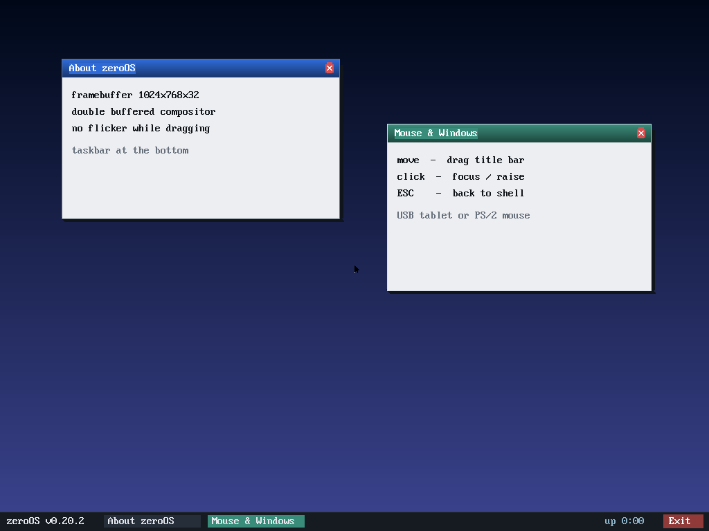

# v0.20.2 — 开机直接进桌面（当前版本）

这一版只有一件事：**不用再输入 `desktop`，开机就是桌面**。
按 ESC / q、点右下角 Exit，或者 60 秒无输入，都会回到命令行。



## 改动

| # | 改动 | 说明 |
|---|---|---|
| ① | `AUTO_DESKTOP` 编译开关 | `make AUTO_DESKTOP=1` 生成“开机进桌面”的镜像；默认 0，自动化测试仍从命令行开始 |
| ② | 桌面自启 | 内核初始化完成后直接调用 `wm_run()`；退出桌面即进入 shell |
| ③ | 保留三重退出 | ESC / q、任务栏 Exit、60 秒空闲自动退回 shell |

## 关于「装一个浏览器」

**现在做不到，而且不是“缺一个包”的问题。** 一个能上网下载东西的浏览器，在这个内核上需要：

1. **网卡驱动**：QEMU/UTM 的 virtio-net（或 e1000），virtqueue + 中断 —— 还没有。
2. **网络栈**：ARP / IPv4 / UDP / TCP / DNS —— 还没有。
3. **TLS**：现在绝大多数网站是 HTTPS，需要 TLS 1.2/1.3 + 密码学实现 —— 还没有。
4. **HTTP 客户端 + 文件系统**：下载要能落盘；现在只有 ATA 驱动，没有文件系统。
5. **浏览器引擎**：HTML/CSS/JS 渲染引擎 —— 移植 NetSurf / LibWeb 需要 POSIX 层、文件系统、更多内存，是数月级工程。

现实可走的路线：

| 阶段 | 内容 | 量级 |
|---|---|---|
| v0.21 | virtio-net + ARP/IPv4/UDP + DNS + `ping` | 几天 |
| v0.22 | TCP + HTTP GET + 简单文件系统（FAT）落盘 + 文本下载器 | 几天 |
| v0.23 | 窗口里的极简文本网页查看器（无 JS/CSS） | 几天 |
| 真浏览器 | 移植引擎 | 数月，且要先把 POSIX/FS/内存补齐 |

所以「当个正常系统用」目前不现实；可以先把它做成**能联网、能下载、能看文本网页**的系统，再谈浏览器。

## 完整体验

```
开机 → 桌面（About zeroOS / Mouse & Windows）
  拖窗口、点 Exit
  ESC / q → 命令行
```

## 完整测试记录

[https://github.com/Holmes-2011/The-Develop-of-zeroOS/blob/main/versions/v0.20.2/TEST-RESULTS.md](https://github.com/Holmes-2011/The-Develop-of-zeroOS/blob/main/versions/v0.20.2/TEST-RESULTS.md)

---

**完整版本档案**：[https://github.com/Holmes-2011/The-Develop-of-zeroOS/blob/main/versions/README.md](https://github.com/Holmes-2011/The-Develop-of-zeroOS/blob/main/versions/README.md)
