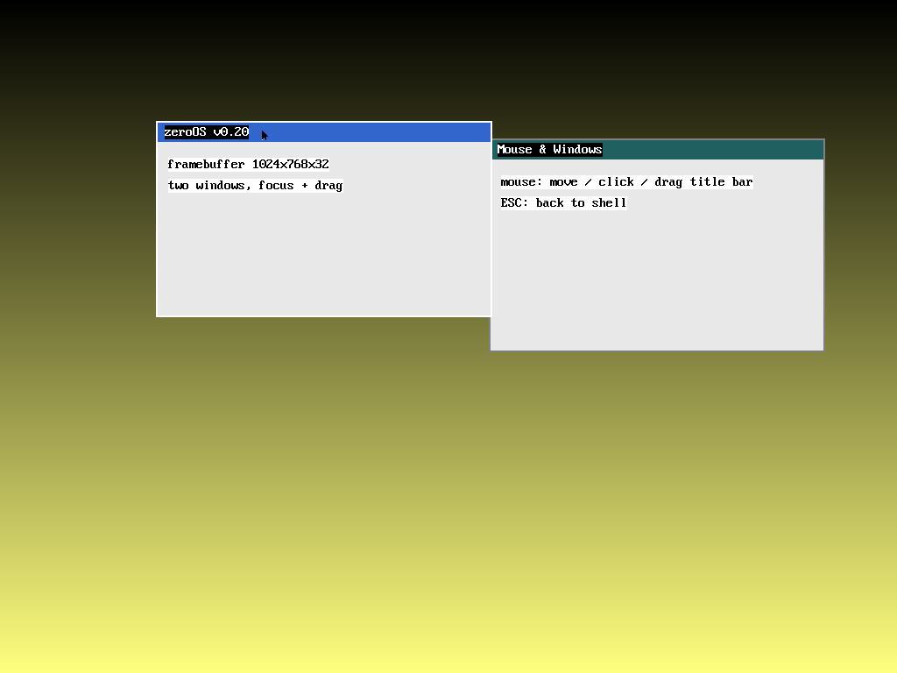

# v0.20 — USB 平板：UTM 里的鼠标也能动了（当前版本）

UTM 给虚拟机的是 **USB 绝对指针（usb-tablet）**，不是 PS/2，所以之前鼠标不动。
这一版补了 USB 栈：PCI 找 UHCI → 端口复位 → 枚举 → HID 中断 IN，读绝对坐标。

## 改动

| # | 改动 | 说明 |
|---|---|---|
| ① | `pci.c` | 最小 PCI 配置空间访问，找到 UHCI（class 0C/03/00） |
| ② | `usb.c` | UHCI：HC 复位、帧列表、端口复位/使能、QH/TD 传输 |
| ③ | 控制传输 | SETUP / 数据 / 状态三阶段；修正 UHCI "max length = 长度-1、0 长度写 0x7FF" 的坑 |
| ④ | 枚举 | SET_ADDRESS → 设备/配置描述符 → 找中断 IN 端点 → SET_CONFIG |
| ⑤ | HID 平板 | 每帧中断 IN 读 5 字节报告（按键 / X / Y），映射到 1024×768 |
| ⑥ | 桌面 | 绝对指针优先于 PS/2 相对指针；两者可同时存在 |

## 验证

| 配置 | 结果 |
|---|---|
| pc（带 usb-tablet） | ✅ 163/163（含 3 项 USB 断言） |
| q35 | ✅ 155/155（USB 阶段只在 pc 跑：驱动目前只支持 PIIX3 UHCI） |
| USB 断言 | `usb: tablet ready`；QMP 注入绝对坐标拖动后 `win0=180,140`；帧缓冲标题栏像素命中 |

> UTM 里现在应该可以直接用鼠标拖窗口了。

## 已知限制

- 只支持 UHCI（PIIX3）；xHCI / EHCI / USB 2.0 高速设备还没做。
- 只实现 HID 平板；USB 键盘、U 盘还需要更多 class 驱动。
- 单端口、单设备；没有 hub 支持。
- 报告按 QEMU usb-tablet 的 5 字节格式解析；其他平板的 HID 描述符可能不同。

## 完整测试记录

[https://github.com/Holmes-2011/The-Develop-of-zeroOS/blob/main/versions/v0.20-usb/TEST-RESULTS.md](https://github.com/Holmes-2011/The-Develop-of-zeroOS/blob/main/versions/v0.20-usb/TEST-RESULTS.md)

---

**完整版本档案**：[https://github.com/Holmes-2011/The-Develop-of-zeroOS/blob/main/versions/README.md](https://github.com/Holmes-2011/The-Develop-of-zeroOS/blob/main/versions/README.md)
