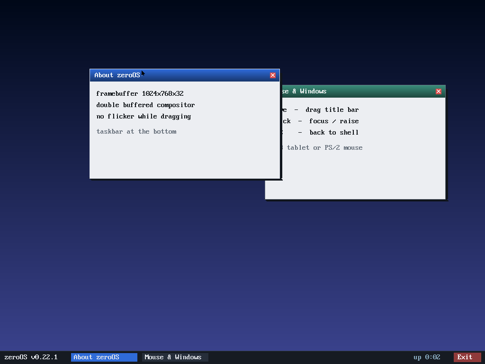

# v0.22.1 — 拖动顺滑：预渲染场景 + 窗口精灵（当前版本）

上一版拖动时，每个鼠标事件都在重画渐变背景、窗口文字和任务栏，TCG 上会一顿一顿。
这一版把拖动拆成三块预计算，移动时只做内存拷贝。



## 改动

| # | 改动 | 说明 |
|---|---|---|
| ① | 拖动开始：预渲染“无窗场景” | 背景渐变 + 任务栏 + 另一个窗口一次性画进后台缓冲 |
| ② | 窗口精灵 | 被拖窗口单独渲染成 `w×h` 像素块（不含周围背景） |
| ③ | 每帧只做拷贝 | 脏区：场景→前台、精灵→前台、阴影/边框几条矩形、指针 |
| ④ | 透明文字 | 标题栏文字不再用纯色背景块，直接叠在渐变上 |
| ⑤ | 修复 | 拖动时不再出现“带一块背景/旧窗口残影”的问题 |

## 原理

```
拖动开始：  scene = 背景 + 任务栏 + 其他窗口    （一次）
            sprite = 被拖窗口的像素            （一次）
拖动中：    present(scene, 脏区) → blit(sprite) → shadow/border → cursor
拖动结束：  整屏重绘一次，恢复普通场景
```

对比上一版：拖动路径里不再有 `bg_rect()` 的逐像素渐变、`gfx_text_at()` 的字形绘制、
任务栏文本；只剩 `memcpy` 和几条 `fill_rect`。

## 验证

| 测试项 | 结果 |
|---|---|
| pc 全套（含网络） | ✅ 166/166 |
| 拖动后 `win0=190,146` | ✅ |
| 拖动中截屏：无背景残影、标题文字贴合渐变 | ✅（人工检查 `docs/images/v0.22.1-drag.png`） |
| USB 平板 / PS/2 拖动 | ✅ |

## 诚实说明

- **没有做 FPS/帧时间测量**；这是结构性优化（去掉每帧重绘），主观上更顺，但我不能给你一个“提升了 X 倍”的数字。
- 仍然是纯 CPU 软件合成，没有 GPU、没有 vsync、没有动画曲线。对标 macOS 的合成器（Core Animation/Quartz）差得远。
- 窗口不透明、无圆角、无模糊；这些要等真正做图层合成再说。

## 完整测试记录

[https://github.com/Holmes-2011/The-Develop-of-zeroOS/blob/main/versions/v0.22.1/TEST-RESULTS.md](https://github.com/Holmes-2011/The-Develop-of-zeroOS/blob/main/versions/v0.22.1/TEST-RESULTS.md)

---

**完整版本档案**：[https://github.com/Holmes-2011/The-Develop-of-zeroOS/blob/main/versions/README.md](https://github.com/Holmes-2011/The-Develop-of-zeroOS/blob/main/versions/README.md)
