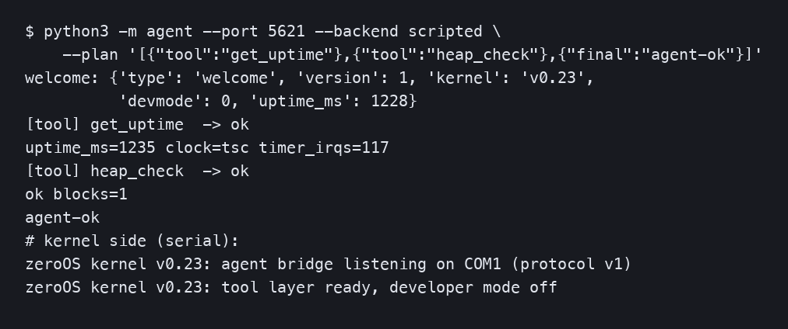

# v0.23 — 宿主侧 Agent 循环接进来（当前版本）

把设计文档里的「Agent 循环 + 可插拔推理引擎」第一次跑通：宿主进程通过串口协议 v1
连上 zeroOS，握手拿工具清单，调用工具，把结果交回循环。



## 改动

| # | 改动 | 位置 |
|---|---|---|
| ① | Agent 循环：模型 → 工具 → 结果 → 模型 | `agent/loop.py` |
| ② | 协议 v1 客户端：hello / tools / call / result / event，重复 hello 容忍早连接 | `agent/protocol.py` |
| ③ | 可插拔后端：`scripted`（确定性，测试用）、`openai-http`（任何 OpenAI 兼容服务） | `agent/backends/` |
| ④ | 命令行：`python -m agent --backend ... --task ...` | `agent/__main__.py` |
| ⑤ | 桌面模式也能被 Agent 调用：`wm_run()` 循环里轮询 `bridge_poll()` | `wm.c` |
| ⑥ | 协议 README + 自动化测试 | `agent/README.md`、`agent/run_agent_test.sh` |

## 实测

```
welcome: {'type': 'welcome', 'version': 1, 'kernel': 'v0.23', 'devmode': 0, ...}
[tool] get_uptime  -> ok
uptime_ms=1235 clock=tsc timer_irqs=117
[tool] heap_check  -> ok
ok blocks=1
```

| 测试项 | 结果 |
|---|---|
| 内核全量 | ✅ 166/166 |
| Agent 脚本后端：get_uptime + heap_check | ✅ 全部通过 |
| 桌面模式（AUTO_DESKTOP=1）下 Agent 调用 | ✅ get_uptime ok |
| OpenAI 兼容后端 | 代码路径（本机未起模型服务） |

## 怎么接你自己的模型

```bash
python3 -m agent --backend openai \
  --base-url http://127.0.0.1:8000/v1 --model my-model \
  --task "看看系统运行了多久"
```

任何暴露 `/v1/chat/completions` + function calling 的服务都行（vLLM / llama.cpp / Ollama / 自研）。
模型换了只换后端；以后搬进 zeroOS 用户态时，换的是传输层（串口 → 系统调用）和推理引擎位置，
Agent 循环、权限、确认框、审计都不变。

## 已知限制

- **模型本身还没接**：仓库里没有结构说明/权重；现在是用 scripted 后端验证整条链路。
- OpenAI 后端只做了最小函数调用适配，没有流式、没有并行工具调用。
- 只读工具可直接调；破坏性/系统级工具会弹内核确认框，需要物理键盘按 y/n。
- UTM 的串口还没暴露成 TCP，Agent 目前连本地 QEMU 的 `-serial tcp:...`。
- 桌面模式下 Agent 可用，但确认框画在控制台层，桌面里看不到——破坏性工具暂时别在桌面模式用。

## 完整测试记录

[https://github.com/Holmes-2011/The-Develop-of-zeroOS/blob/main/versions/v0.23-agent/TEST-RESULTS.md](https://github.com/Holmes-2011/The-Develop-of-zeroOS/blob/main/versions/v0.23-agent/TEST-RESULTS.md)

---

**完整版本档案**：[https://github.com/Holmes-2011/The-Develop-of-zeroOS/blob/main/versions/README.md](https://github.com/Holmes-2011/The-Develop-of-zeroOS/blob/main/versions/README.md)
